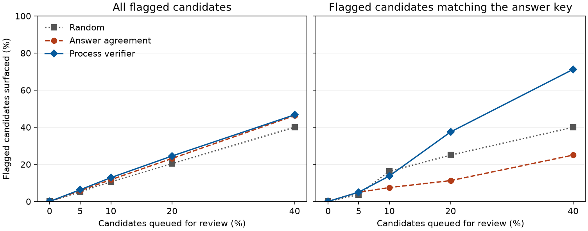

# Results

With 439 review slots, the process verifier surfaced **403** solutions that humans had flagged, compared with **381** for final-answer agreement. The overall gain was below the practical target. Almost all of the gain came from solutions whose final answer matched the answer key, where the verifier surfaced **30 of 80** flags and agreement surfaced **9**.

## What the data contains

The PRM800K Phase 2 archive contains 2,762 human annotation records. The pilot used 530 records from 88 problems. The evaluation used 2,232 records from another 370 problems. Merging repeat annotations left **2,195 unique solutions** for evaluation. The primary finish-code rule classified 1,643 as flagged, 481 as cleared, and 71 as unresolved. Unresolved candidates still used review slots when selected. Only flagged and cleared candidates enter the rate denominators that depend on a conclusive label. Overall, 77.4% of resolved candidates in this selected archive were flagged. [Data provenance and label definitions](METHODS.md)

After collapsing whitespace, 413 final answers matched the answer key string. Of the 407 with a conclusive label, **80 (19.7%)** were flagged. A flag can reflect an incorrect step, an incomplete derivation, or another issue with the explanation.

For example, one solution correctly answered that exactly two two-digit squares end in 6. It incorrectly identified those squares using 4² and 8². The squares are 16 and 36, from 4² and 6². An annotator flagged that step. The process verifier queued the solution 330th, inside the 439-slot budget. Answer agreement queued it 954th. See source line 595 in the pinned input.

## What 439 reviews surfaced

| Queue | All flags found (of 1,643) | Recall | Flags with matching answers found (of 80) | Match recall | Review precision | Unresolved reviews |
| --- | ---: | ---: | ---: | ---: | ---: | ---: |
| Random | 335 | 20.4% | 20 | 25.0% | 79.6% | 18 |
| Answer agreement | 381 | 23.2% | 9 | 11.3% | 90.9% | 20 |
| Process verifier | 403 | 24.5% | 30 | 37.5% | 96.0% | 19 |

Precision uses only resolved reviews as its denominator. Among resolved candidates left unreviewed, 76.8% were flagged under random review, 74.0% under agreement, and 72.8% under the process verifier. Even a perfect 439-slot queue could have surfaced only 26.7% of the 1,643 flagged candidates. [Full counts](../results/summary.csv)

**Overall recall.** The verifier's advantage was **1.34 percentage points** (paired 95% interval **0.43 to 2.36**). It found 22 extra flags, or five extra per 100 review slots. The post-pilot criterion of a 2-point gain would require at least 33 extra flags. The point estimate missed that criterion, and the interval includes 2 points. Only 127 of the 439 selections appeared in both queues.

**Recall when the answer matched the key.** The secondary advantage was **26.25 percentage points** (descriptive 95% interval **13.89 to 39.19**). This group accounted for 21 of the verifier's 22 net additional flags. This shows how similar overall recall can conceal large differences in which failures an oversight policy surfaces. Both intervals use 2,000 paired draws of whole problems. [Bootstrap output](../results/manifest.json)

## How the budget changed the result

At 5%, the verifier and agreement each found four flagged solutions that matched the key. At 10%, the verifier found 11 of 80, agreement found six, and the seeded random queue found 13. At 40%, the verifier found 57 and agreement found 20, while the overall difference narrowed to seven. At that budget the verifier caught 37 more flags with matching answers and 30 fewer outside that group. Agreement could miss problems even when all archived answers were identical. Of the 39 resolved candidates in unanimous pools, humans flagged 17, all with answer strings that differed from the key. [Budget sensitivity](../results/summary.csv)

## How sensitive are these findings?

At 20%, PRM800K's answer normalizer changed the number of flagged key matches from 80 to 96. With both matching and agreement normalized, the verifier surfaced **35 of those 96**, compared with **9** for agreement. Counting negative ratings along the original solution path also left the overall gain small and the key-match gain large.

Under the primary agreement rule, 1,103 candidates tied for the 439 slots. Only 24 members of that tied group were flagged key matches. Even a tie-break that selected all 24 would reach fewer than the verifier's 30. The [accuracy checks](AUDIT.md) give the calculations, alternate counts, and examples where the answer normalizer was helpful or misleading.

## What the study establishes

In this archive, comparing final answers offered a useful way to queue many flawed solutions, and the process verifier brought substantially more flagged derivations with matching answers to the front. The replay measures selection for inspection. A live study would be needed to measure whether reviewers detect, repair, or block the flagged material.

The source study used process-verifier scores to choose solutions for annotation, and both queues worked on those selected pools. A fresh sample could have a different mix of errors and a different pattern of answer agreement. The reported intervals describe variation across these problems. Extending the finding beyond this setup would require testing other models, tasks, and review costs.
